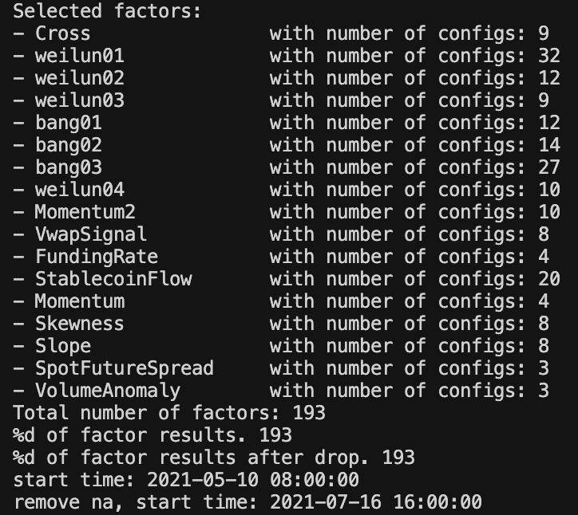
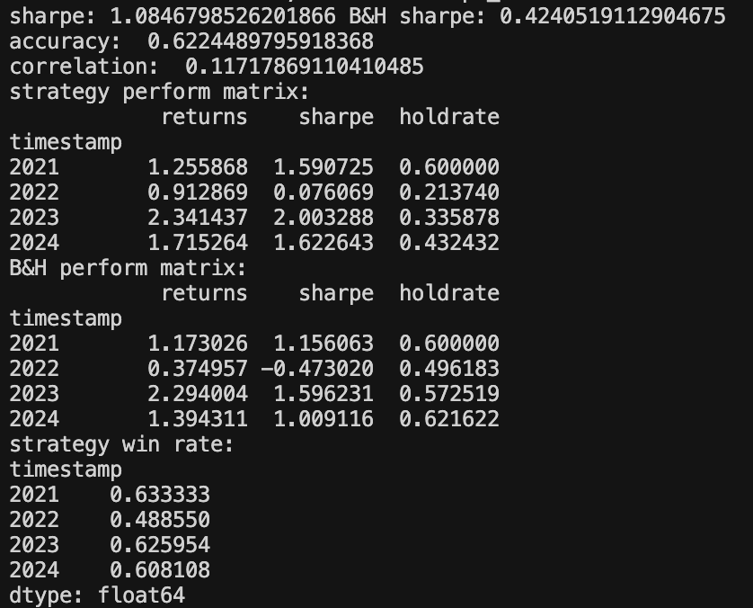
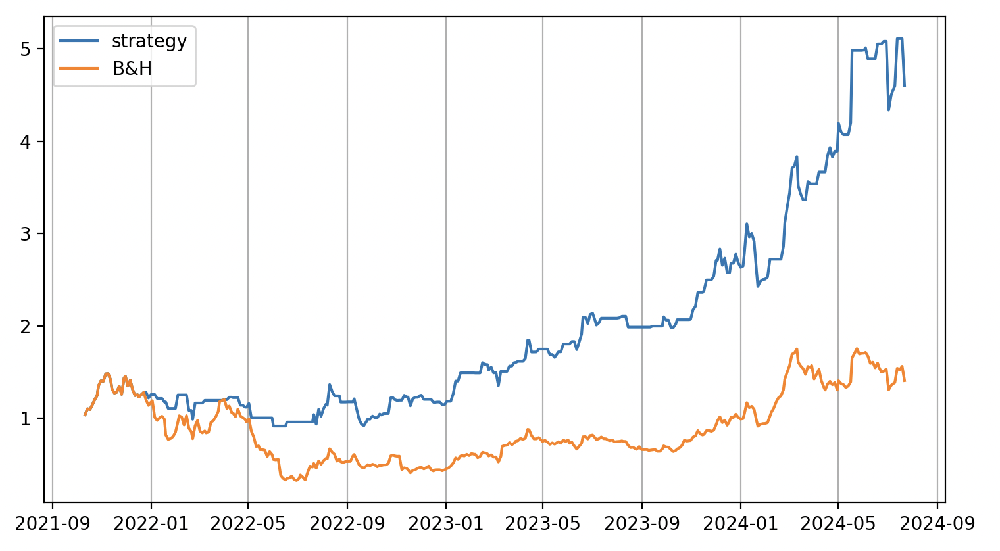

# CryptoPredictor

A modular cryptocurrency factor research and backtesting framework, designed for rapid prototyping and evaluation of alpha signals.

This project enables systematic fetching, storage, analysis, and backtesting of crypto market data, facilitating research into single-factor and multi-factor portfolio strategies.

---

## Project Structure
```
CryptoPredictor/
├── data/          # Data fetching and storage scripts
├── signal/        # Signal (factor) implementations
├── cfg/           # Signal configuration files
├── backtest/      # Backtesting engine
├── utils/         # Utility functions
├── requirements.txt
└── README.md
```

---

## Installation

Clone the repository and install all dependencies:

```bash
pip install -r requirements.txt
```

---

## 1. Fetch and Store Crypto Market Data Locally

A custom-designed `data/crawl.py` script automatically collects and organizes diverse market datasets:

- Spot prices
- Futures market data (price, open interest)
- Funding rates
- Trading volumes and liquidity indicators

Data are stored in `data/storage/`, enabling reproducible research without reliance on third-party APIs at runtime.
The fetching system supports periodic updates, ensuring that datasets remain fresh for ongoing research and model retraining.

```bash
python data/crawl.py
```

✅ **Highlights**:  
- Robust local data pipeline  
- Support for multiple market features  
- Designed for large-scale historical analysis

---

## 2. Develop and Evaluate Single-Factor Signals

Each factor is implemented as a self-contained Python class and is paired with a JSON configuration for parameter control.
The standardized interface allows factors to be seamlessly integrated into the backtesting framework.

- Analyze the **correlation** between the factor and future returns.
- Test **adaptability** across different market regimes (bull, bear, sideways).
- Automatically log and visualize performance metrics.

To develop a new signal:

1. Create a Python class in `signal/`.
2. Create a corresponding JSON config in `cfg/`.
3. Ensure class name, filename, and config name are consistent.

Example:

```bash
# Backtest a specific signal
python -m backtest.test_factor Cross
```



✅ **Highlights**:  
- Clean plug-and-play factor design  
- Config-driven parameterization  
- Full historical backtesting with visualization

---

## 3. Combine Factors for Portfolio Construction

Multiple validated factors are aggregated to build a diversified multi-signal portfolio:

- Simple weighted combinations or dynamic weighting schemes
- Risk-parity, Sharpe-optimized, or regime-dependent factor models
- Full portfolio backtesting, including drawdown, volatility, turnover metrics

To run portfolio backtests:

```bash
python -m backtest.factor_model
```




✅ **Highlights**:  
- Modular factor ensemble system  
- Optimized for robustness and stability  
- Supports rapid experimentation with different portfolio construction methods

---


## Key Engineering Contributions

- **Built an end-to-end crypto research infrastructure** from data ingestion to backtesting.
- **Designed a flexible factor engine** allowing fast prototyping of signals.
- **Implemented robust local storage system** to decouple research from API rate limits and network instability.
- **Structured backtesting framework** with consistent interfaces and extensible design patterns.
- **Enabled scalable factor combination experiments**, supporting multi-signal portfolio strategies.

---

## Future Work

- Add live trading simulation
- Enhance signal ensemble models using machine learning techniques
- Expand to additional asset classes (e.g., altcoins, options)

---

# 🚀 Project Status
**Stable for research use.**  
Continuously improving modularity and performance based on experimental results.

---
